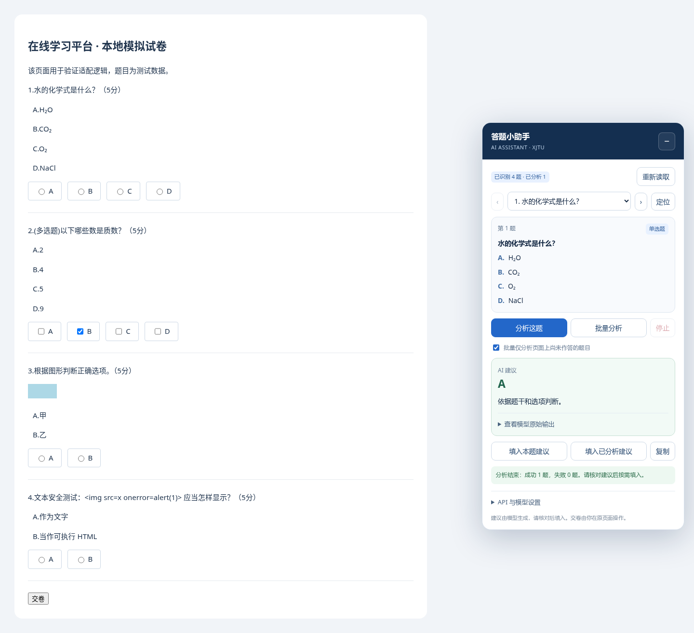

# XJTU Labor Education Automation Scripts

适用于 [西安交通大学在线学习平台](https://vpahw.xjtu.edu.cn/) 的两个独立油猴脚本：AI 答题辅助和视频播放解锁。

## 脚本

| 脚本 | 功能 | 入口 |
| --- | --- | --- |
| AI 答题助手 | 自定义 API、API Key 和模型；读取单选/多选题；单题或批量分析；显示解析；按需填入建议；导入导出配置 | [xjtu-ai-helper.user.js](scripts/xjtu-ai-helper.user.js) |
| 视频播放解锁 | 解锁进度条；提供 1、1.5、2、4、8、16 倍速；跳转到视频结尾；调整后台播放行为 | [xjtu-video-unlock.user.js](scripts/xjtu-video-unlock.user.js) |

两个脚本放在同一仓库，分别安装。AI 助手使用 `document-idle` 和油猴授权 API；视频脚本使用 `document-start`，需要尽早处理播放器初始化，因此保留为两个文件。

## 安装

1. 在使用学习平台的浏览器中安装 [Tampermonkey（油猴）](https://www.tampermonkey.net/)。
2. 打开油猴菜单，选择 **添加新脚本**，删除编辑器中的默认内容。
3. 打开上方需要安装的 `.user.js` 文件，复制全部内容到油猴编辑器，按 `Ctrl+S` 保存。两个脚本分别重复此步骤。
4. 确保脚本已启用，然后刷新学习平台页面。安装新版本后，停用此前重复安装的旧脚本。

GitHub 上可进入脚本文件并点击 **Raw**，由油猴识别安装；如果浏览器没有弹出安装页，使用上述复制方式即可。详见[油猴安装脚本说明](https://www.tampermonkey.net/faq.php?q=Q102)。

Chrome 系浏览器如果没有执行脚本，请检查油猴扩展的 **允许用户脚本** 和网站访问权限；部分浏览器版本需要启用开发者模式，见[官方权限说明](https://www.tampermonkey.net/faq.php?q=Q209)。

## AI 答题助手

从课程页面进入考试后，使用右下角的 **答题小助手** 面板：

1. 展开 **API 与模型设置**，填写 Chat Completions 兼容 API 地址、Key 和模型 ID。
2. 点击 **保存设置**、**测试连接**。也可以先点击 **获取模型** 查看候选模型。
3. 选择题目，点击 **分析这题** 或 **批量分析**，查看建议和解析。
4. 核对后点击 **填入本题建议** 或 **填入已分析建议**。交卷使用原页面按钮。

API 地址接受根路径或完整的 `/chat/completions` 地址，例如 `https://你的接口域名/v1`。脚本只补 `/chat/completions`，不会自动添加 `/v1`。本版本需要兼容接口，不直接使用原生 Messages、generateContent 或 Responses 协议。

可以修改 [JSON 配置示例](examples/ai-config.example.json)，再在面板中导入。更多设置、排错与数据保存说明见 [AI 助手使用文档](docs/ai-helper.md)。

题干、选项及补充要求会发送到配置的 API 服务。密钥与自定义请求头默认仅保留在当前页面会话中，可按需选择保存在油猴存储。导出配置会移除密钥、请求头及 URL 查询参数；分享前仍应检查自行填入的其他字段。

图片题目前只提取文字，并禁止自动填入。填空和简答题不在当前适配范围内。

<details>
<summary>查看 AI 助手界面预览（本地模拟页面）</summary>



</details>

## 视频播放解锁

打开视频章节并刷新，使用右上角的 **播放器解锁** 面板：

- 点击倍速按钮，选择播放速度。
- 点击 **解锁进度条**，重新应用播放器解锁设置。
- 点击 **跳到结尾**，将播放位置移到结束前约 0.4 秒并尝试继续播放。
- 点击面板标题，可收起或展开控制按钮。

视频脚本按用户提供的原始内容收录，未改动其行为。它处理 ckplayer 的进度和倍速设置、媒体元素的倍速属性以及页面可见性。跳到结尾后，进度是否记录成功由平台自己的逻辑与校验决定，以平台实际显示为准。

## 仓库结构

```text
.
├── README.md
├── .gitignore
├── scripts/
│   ├── xjtu-ai-helper.user.js
│   └── xjtu-video-unlock.user.js
├── examples/
│   └── ai-config.example.json
└── docs/
    ├── ai-helper.md
    └── assets/
        └── ai-helper-preview.png
```

脚本没有构建步骤或第三方运行时依赖，安装到油猴后即可使用。此仓库不包含 API 密钥或个人配置。`.gitignore` 排除了常见本地配置和环境文件；新增配置文件时仍需检查是否含凭据。

## 验证与维护

AI 助手根据 **2026-11-11** 平台公开前端结构适配，已通过 35 项本地 Chromium 浏览器检查，覆盖题目识别、React 单选/多选回填、配置处理、异常响应、限流、停止、超时及页面变化。验证使用本地模拟页面和模拟 API，尚未通过真实登录会话与付费 API 联调。

视频脚本在本仓库中进行了 JavaScript 语法检查，尚未进行真实播放器与服务端进度记录的联调。平台升级后，两份脚本都可能需要调整。

修改后可用 Node.js 进行基本语法检查：

```sh
node --check scripts/xjtu-ai-helper.user.js
node --check scripts/xjtu-video-unlock.user.js
```

AI 助手由本次工作编写；视频脚本由用户提供。仓库目前未指定开源许可证。
